# AegisAI — Enterprise AI Security & Governance Gateway

AegisAI is a centralized AI security and governance gateway for organizations that want to use AI models while applying consistent access, privacy, policy, and audit controls.

An organization can route AI requests from its internal applications, teams, and AI-powered products through AegisAI rather than allowing each application to connect independently to model providers. The gateway provides a common control point for checking requests, applying privacy protections and organizational policies, selecting an approved model/provider, and recording activity for review.

This README is a **frontend user guide**. The screenshots show one organization's workspace and its available application views. The remaining functionality is explained in text so the guide stays focused and easy to follow.

---

## 1. How an organization uses AegisAI

A typical organization uses AegisAI in the following way:

1. The organization creates user accounts and assigns roles.
2. The administrator configures the AI models and providers the organization permits.
3. The administrator defines policies and approval requirements.
4. Developers submit AI prompts through the AegisAI gateway from the frontend or an integrated application.
5. AegisAI authenticates and validates the request, scans its content for sensitive information, evaluates applicable policies, and routes an allowed request to a configured provider.
6. The developer receives the AI response or sees whether the request was blocked or requires approval.
7. Security personnel review security events, audit records, and request traces.

```text
Organization users and applications
                 |
                 v
            AegisAI
                 |
       Identity and validation
                 |
          Privacy scanning
                 |
          Policy evaluation
                 |
           Model routing
                 |
          AI model provider
                 |
           AI response
                 |
       Audit and request traces
```

AegisAI is useful when an organization wants to:
- Centralize AI access across multiple teams and applications.
- Reduce the chance of sending personal information, credentials, or other sensitive content to an AI provider.
- Apply consistent organizational rules to AI requests.
- Control which models and providers are available.
- Require approval for requests that meet configured conditions.
- Maintain visibility into AI usage and security-related activity.

---

## 2. Roles in an organization

AegisAI separates responsibilities through role-based access. The three main roles are:

| Role | Responsibility |
|---|---|
| **Organization Administrator** | Sets up the workspace, manages identities, configures models/providers, and maintains policies and approvals. |
| **Developer** | Uses the gateway to submit AI requests, view responses, and test how privacy scanning handles input. |
| **Security Auditor** | Reviews security events, audit records, and request traces to support monitoring and accountability. |

The screenshots below are from one organization workspace. They are examples of the frontend, not separate installations or separate organizations.

## 3. Organization workspace — frontend screenshots

### Organization overview

The Overview page gives the organization a high-level view of its AI request pipeline. It summarizes request activity, including total, completed, blocked, failed, and pending-approval requests, along with recent AI requests and security events.

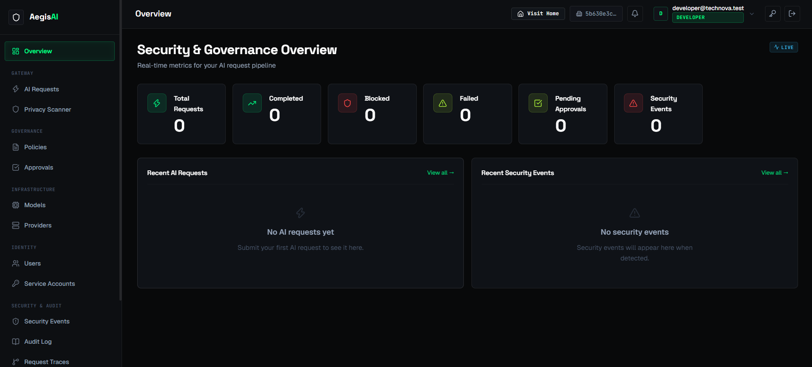

### Users and roles

The Users area allows an administrator to view organization accounts and their assigned roles. In this example workspace, the user list includes an organization administrator, a developer, and a security auditor.

The Service Accounts area is used for application or service identities that need to interact with AegisAI.

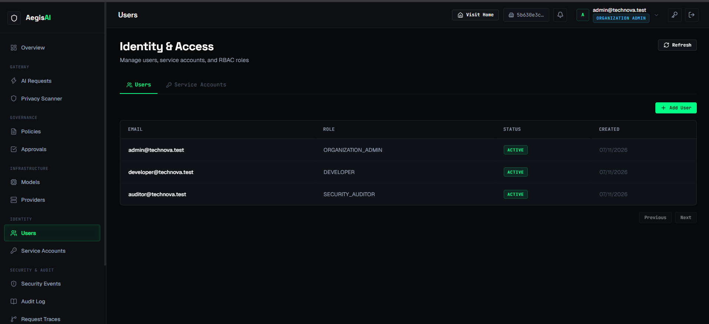

### Models and providers

The Models and Providers area is where an administrator manages the AI models and upstream provider configurations available to the gateway. Model entries can be reviewed for their provider association, active status, and sensitivity classification. The provider configuration area maintains the upstream connections used for model requests.

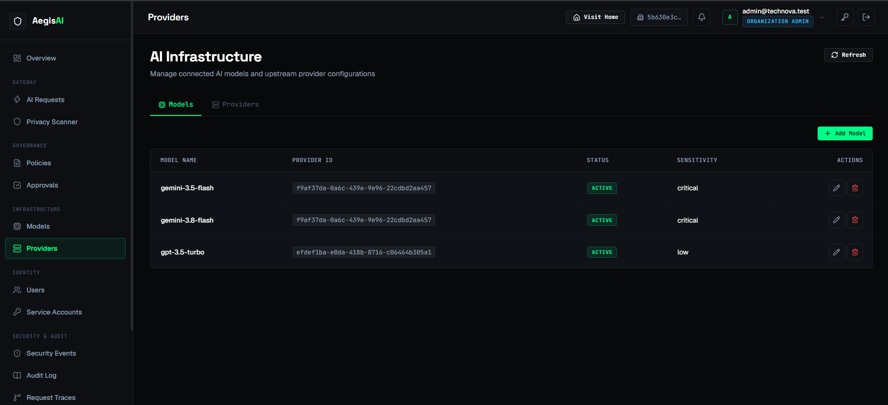

### Privacy Scanner

The Privacy Scanner provides a sandbox for trying the privacy-scanning service with sample text. It can identify supported sensitive data such as email addresses, phone numbers, PAN, Aadhaar, API keys, and passwords. Based on the configured policy, a finding can lead to an action such as **MASK**, **BLOCK**, or **REQUIRE_APPROVAL**.

When a finding is masked, the interface displays the detected type, suggested action, location, confidence, and masked output. Use synthetic or approved sample data when testing; never paste real credentials or confidential personal information into a demonstration.

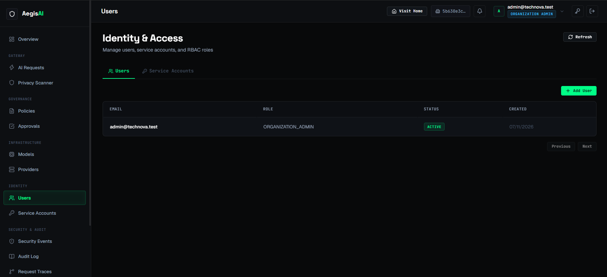

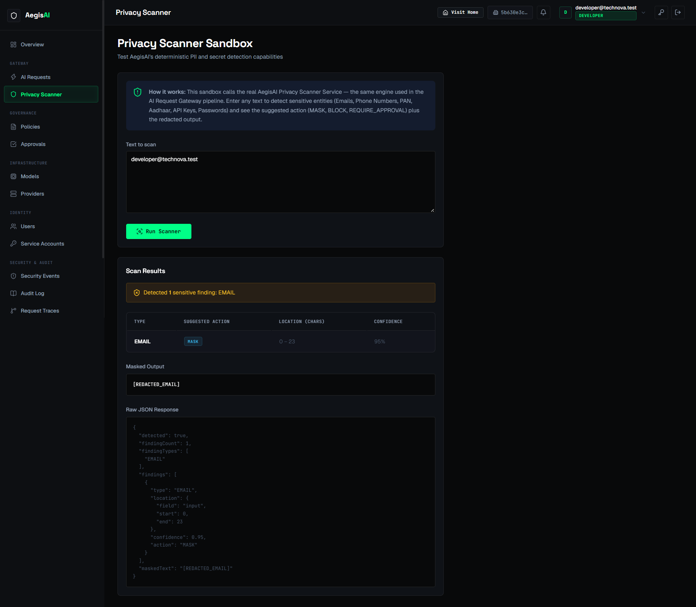

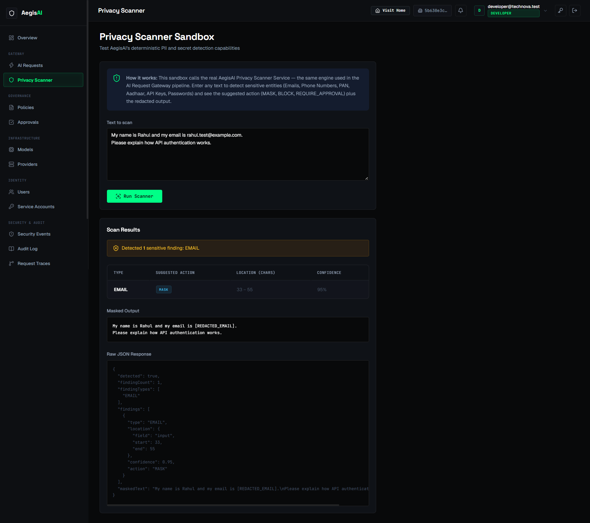

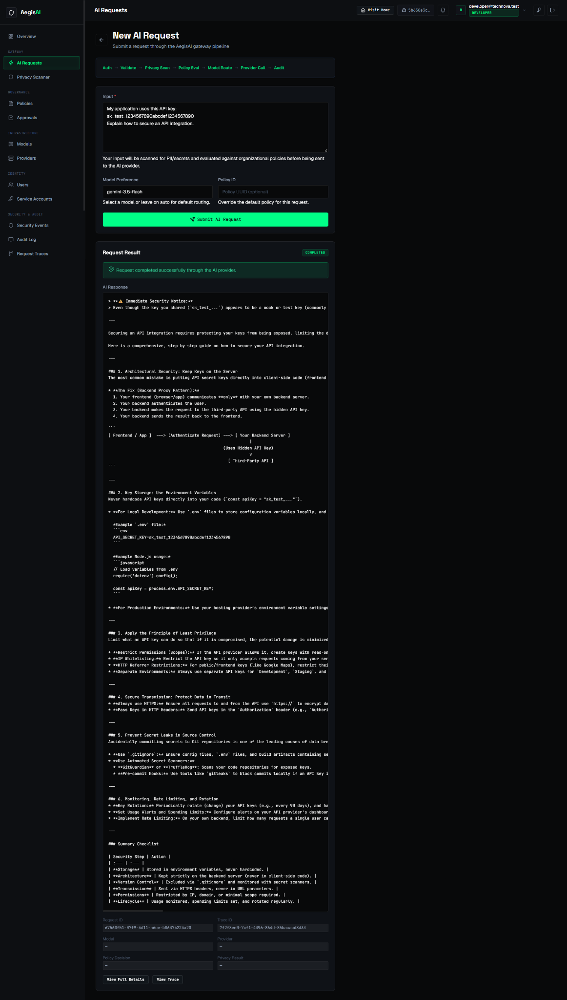

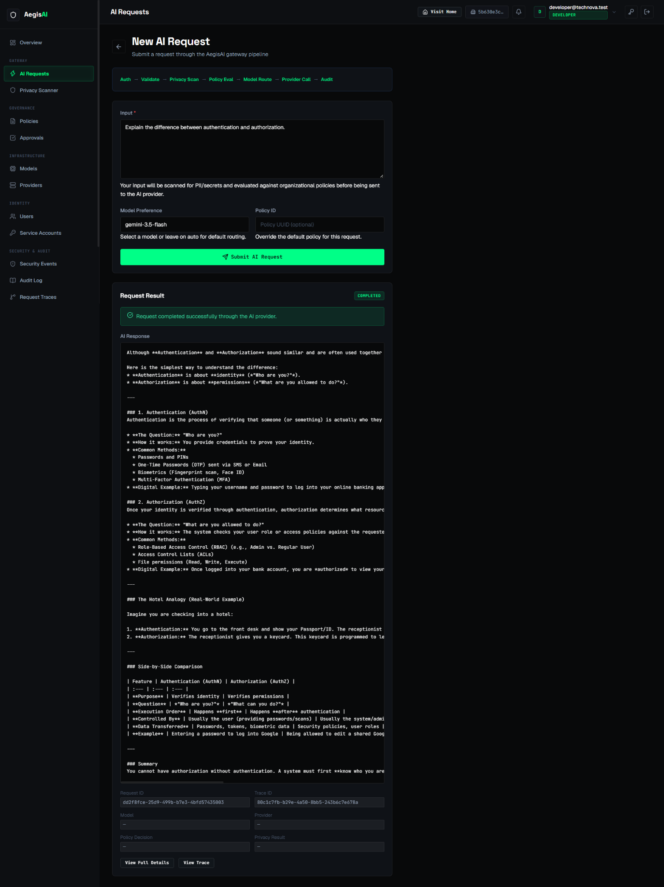

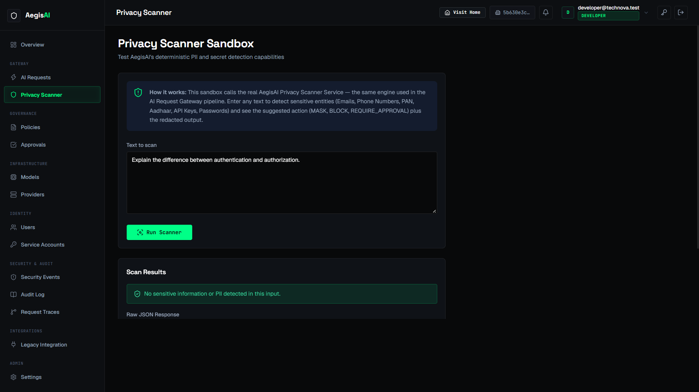

### AI Requests

The AI Requests page lets a developer submit a prompt through the AegisAI gateway. The form includes the prompt, an optional model preference, and an optional policy ID override. The page shows the gateway pipeline stages:

**Auth → Validate → Privacy Scan → Policy Eval → Model Route → Provider Call → Audit**

After submission, the Request Result area displays the request outcome and the AI response. Where available, the developer can open the full request details or its trace.

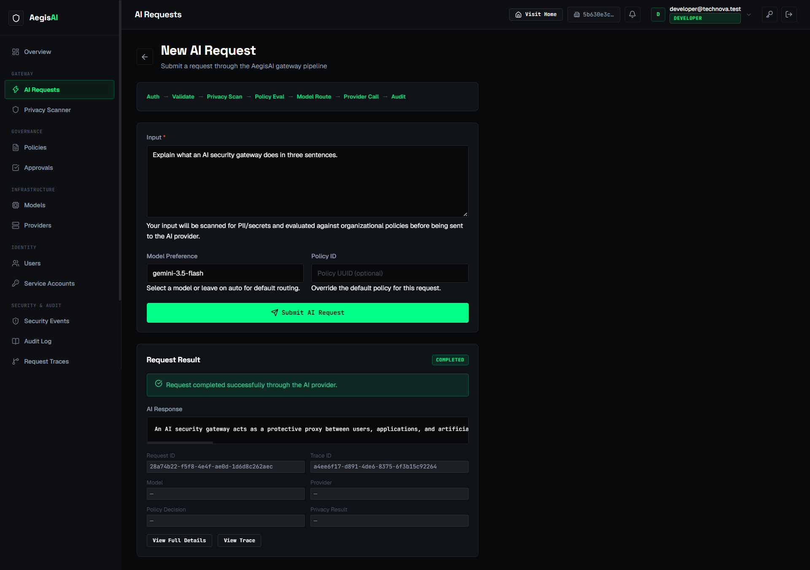

### Governance dashboard

The dashboard also provides a view of request and security activity. Administrators and auditors can use the relevant dashboard information as a starting point before opening the detailed security and audit pages.

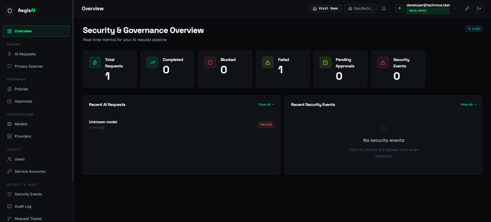

---

## 4. Organization Administrator — functionality guide

The Organization Administrator is responsible for preparing and governing the organization's AegisAI workspace.

### Overview
- Monitor the overall AI request pipeline.
- Review request counts and statuses, including completed, blocked, failed, and pending approvals.
- See recent AI requests and recent security events.

### Identity and access
- **Users:** create and manage user accounts and assign appropriate roles.
- **Service Accounts:** manage identities used by applications and backend services.
- Apply role-based access so users can access only the functions required for their responsibilities.

### AI infrastructure
- **Models:** add and maintain model entries, associate them with providers, and review their status and sensitivity classification.
- **Providers:** configure and maintain upstream AI provider connections used by the gateway.

### Governance
- **Policies:** define organizational rules that govern how AI requests are handled.
- **Approvals:** review requests that have been routed for an approval decision. Authorized approvers can take action according to the organization's review process.

### Administration
- **Settings:** access environment-managed configuration areas where enabled. Configuration that is controlled by the deployment environment should be maintained through the appropriate administrative process.

**Suggested administrator sequence:** review Overview → configure Users and Service Accounts → configure Models and Providers → define Policies → establish the Approvals process → monitor activity.

---

## 5. Developer — functionality guide

The Developer uses AegisAI to access approved AI capabilities through the organization's gateway.

### AI Requests
1. Open **AI Requests** and choose to create a new request.
2. Enter the prompt in the Input field.
3. Select a Model Preference if required, or leave the default routing behavior in place.
4. Optionally provide a Policy ID when an authorized workflow requires a policy override.
5. Submit the AI request.
6. Review the request status and the AI Response.
7. Use **View Full Details** or **View Trace** when those controls are available and the account has permission.

The gateway applies the configured request-processing stages before the prompt reaches the model provider. A request may complete, be blocked, fail, or require approval depending on the request and the organization's configuration.

### Privacy Scanner
- Paste sample text into **Text to scan**.
- Select **Run Scanner**.
- Review whether sensitive information was detected.
- If findings are present, review their type, suggested action, confidence, and masked output.
- Use the scanner to understand how the organization's privacy controls treat sample prompt content.

### Developer responsibilities
- Use only approved models and providers.
- Avoid placing real secrets or confidential information in test prompts.
- Do not attempt to bypass organizational policies.
- Contact the administrator if a required model, provider, or permission is unavailable.

---

## 6. Security Auditor — functionality guide

The Security Auditor focuses on visibility, review, and accountability.

### Security Events
Review security-related events recorded by AegisAI. This area can help an auditor identify activity that may need further investigation.

### Audit Log
Review recorded platform actions and events. Audit records provide a history that can support internal reviews and accountability.

### Request Traces
Inspect request-level trace information to understand the lifecycle of an AI request and the processing stages recorded for it.

### Overview
Use the dashboard as a high-level summary of AI request activity and recent security events. Open the detailed event, audit, or trace pages when a closer review is needed.

**Suggested auditor sequence:** review Overview → inspect Security Events → examine relevant Audit Log entries → follow related Request Traces → share findings through the organization's security process.

---

## 7. Functional areas at a glance

| Frontend area | Purpose |
|---|---|
| **Overview** | High-level request, governance, and security activity |
| **AI Requests** | Submit prompts through the gateway and view AI responses and request outcomes |
| **Privacy Scanner** | Detect supported sensitive data and display recommended actions and masked output |
| **Policies** | Define rules for handling AI requests |
| **Approvals** | Review requests that require an approval decision |
| **Models** | Manage model entries and their provider associations |
| **Providers** | Manage upstream AI provider configurations |
| **Users** | Manage organization user accounts and roles |
| **Service Accounts** | Manage application/service identities |
| **Security Events** | Review security-related activity |
| **Audit Log** | Review recorded actions and events |
| **Request Traces** | Inspect request-level processing history |
| **Legacy Integration** | Access legacy-system integration functionality where configured |
| **Settings** | View environment-managed configuration areas where enabled |

---

## 8. Example: onboarding an organization

Consider an organization that wants its internal support portal to use an AI model.

1. The **Organization Administrator** creates accounts for the developers and auditors, assigns their roles, and configures the models and providers approved by the organization.
2. The administrator defines policies for handling prompts and configures which situations require approval.
3. The **Developer** integrates the support portal with AegisAI and submits requests through the gateway.
4. AegisAI checks the request, scans for sensitive content, evaluates the applicable policy, and routes permitted requests to an approved provider.
5. The developer receives the model response or follows the displayed blocked or approval-required outcome.
6. The **Security Auditor** reviews the related security events, audit records, and request traces.
7. The administrator can refine access, policies, and provider configuration as the organization's needs change.

This workflow gives the organization a consistent way to manage AI usage across its applications while maintaining privacy controls and an audit trail.

---

## 9. Responsible use

- Use synthetic or organization-approved sample data when demonstrating AegisAI.
- Never include real API keys, passwords, access tokens, or confidential personal information in screenshots or sample prompts.
- Assign users the minimum access needed for their responsibilities.
- Follow the organization's security and incident-response procedures when an event needs investigation.
- The pages and actions visible to each user depend on assigned permissions and environment configuration.

---

*This document describes the AegisAI frontend from the perspective of one organization and its Organization Administrator, Developer, and Security Auditor roles. It intentionally focuses on user-facing functionality rather than backend console output, database verification, or deployment logs.*
