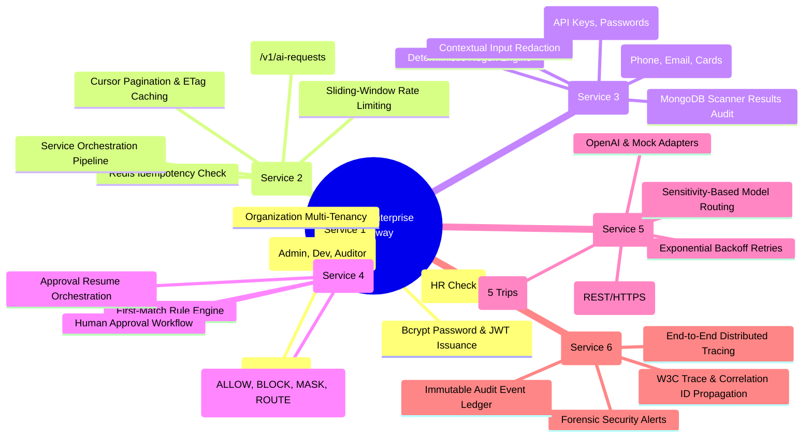
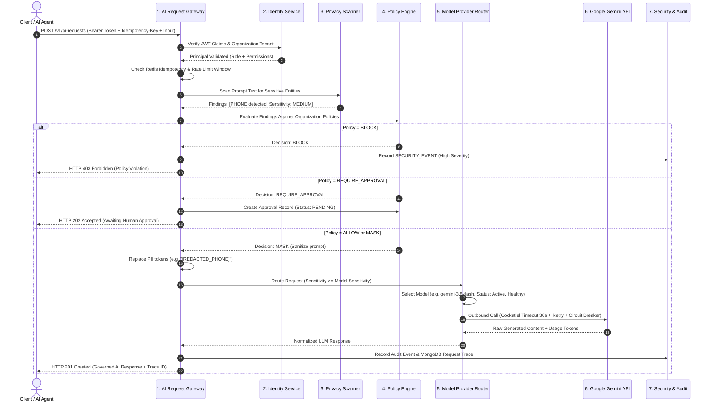

# AegisAI — Complete Technical & Presentation Reference

> **Document Purpose:** Single source of truth for the entire AegisAI project. Designed for team members (Neha Nupur, Aditi Garg, Shivam Kumar Soni) to understand, prepare, and confidently defend the system architecture, code implementation, service boundaries, and 28 Web Services requirements in front of the course professor.  
> **Source Verification Date:** October 2026  
> **Repository Root:** `d:/Neha/IIITV/Sem 3/Web Services/AegisAi claude/aegisai`  
> **Architecture Pattern:** Modular Monolith (6 logical services with independent layering, private repositories, and shared contract types)

---

## 1. Executive Summary & Introduction

### 1.1 What is AegisAI?
**AegisAI** is an **Enterprise AI Security & Governance Gateway**. It acts as an intelligent, policy-governed control plane positioned directly between client applications (frontends, developer tools, internal backend services, automated AI agents) and third-party frontier AI model providers (Google Gemini, OpenAI, or self-hosted LLMs).

In simple terms:
> *"Instead of allowing applications to talk directly to external AI providers, AegisAI intercepts every request. It verifies who is calling, checks what data is inside the prompt, enforces company safety policies, picks the right AI model, and logs an immutable audit trail."*

```
Client Application / AI Agent
              │
              ▼
   ┌────────────────────────────────────────────────────────┐
   │                  AEGISAI GATEWAY                       │
   │  [JWT Auth] ➔ [Validation] ➔ [Idempotency] ➔ [Rate]   │
   │  [Privacy Scan] ➔ [Policy Guardrail] ➔ [Model Router] │
   └────────────────────────────────────────────────────────┘
              │
              ▼
    External AI Provider (Gemini / OpenAI)
              │
              ▼
   ┌────────────────────────────────────────────────────────┐
   │             RESPONSE & AUDIT ENGINE                    │
   │  [Sanitization] ➔ [Trace Log] ➔ [Security Events]     │
   └────────────────────────────────────────────────────────┘
              │
              ▼
   Sanitized Response to Client
```

---

### 1.2 The Core Problem AegisAI Solves
When enterprises adopt generative AI directly:
1. **Uncontrolled Data Exposure:** Employees or software agents copy-paste customer phone numbers, personal emails, internal API keys, passwords, or credit card numbers into LLM prompts.
2. **Zero Compliance & Visibility:** Central IT has no unified log of who asked what, which model responded, or how much token quota was consumed.
3. **Vendor Lock-in & Reliability Failures:** If a single AI provider experiences an outage, rate limit (HTTP 429), or network timeout, the application crashes without fallback or circuit breaking.
4. **Lack of Policy Enforcement:** Organizations cannot programmatically enforce rules like *"Block any prompt containing AWS secret keys"* or *"Require human administrator approval before running prompts touching financial data"*.

---

### 1.3 What Happens With vs. Without AegisAI

| Dimension | Direct LLM Integration (Without AegisAI) | Governed Integration (With AegisAI) |
|---|---|---|
| **Security Perimeter** | Prompts bypass company inspection entirely | Every prompt is scanned for PII and enterprise secrets |
| **Authentication** | Hardcoded provider keys exposed to clients | Cryptographically signed JWT tokens with RBAC |
| **Policy Control** | All-or-nothing access | Declarative rules: `ALLOW`, `BLOCK`, `MASK`, `REQUIRE_APPROVAL` |
| **Vendor Resilience** | Single point of failure if API is degraded | Circuit breaker (`cockatiel`), exponential backoff, auto-failover |
| **Compliance & Audit** | Zero internal logging | End-to-end distributed request traces and MongoDB audit logs |
| **Cost & Duplication** | Duplicate prompts trigger duplicate paid API calls | Redis idempotency keys return cached answers with 0 added cost |

---

### 1.4 Main Actors & Personas
AegisAI defines 3 distinct user roles enforced by Role-Based Access Control (RBAC):
- **`ORGANIZATION_ADMIN`:** Full administrative control. Configures enterprise guardrail policies, reviews pending human approvals, registers models/providers, views security alerts, and manages users.
- **`DEVELOPER`:** Submits AI requests via REST/GraphQL, configures service accounts for automated microservice agents, and tests prompts in the Privacy Scanner sandbox.
- **`SECURITY_AUDITOR`:** Read-only oversight persona. Inspects chronological audit logs, forensic security events, and deep distributed request traces without permissions to modify policies or models.

---

## 2. Technology Stack

Every technology used in the active codebase is verified and summarized below:

| Layer | Technology | Why We Use It | Where Used in Codebase |
|---|---|---|---|
| **Runtime** | Node.js (v20+ / v22) | High-throughput asynchronous event-loop for gateway proxying | Monorepo runtime across all services |
| **Language** | TypeScript (v5.6.3) | Strict compile-time typing, contract interfaces, and shared types | `packages/shared-types`, monorepo packages & apps |
| **Backend Framework** | Express (v4.21.1) | Modular routing, pipeline middleware, standard HTTP handlers | `apps/api/src/app.ts`, service routers |
| **Frontend Framework** | React (v19) + Vite (v8.3.4) | Fast Single Page Application (SPA), componentized dashboard | `apps/frontend/src/` |
| **Styling** | Vanilla CSS + Tailwind v4 | Obsidian Sentinel high-contrast theme, custom HUD cards | `apps/frontend/src/index.css` |
| **Primary Relational DB** | PostgreSQL 16 | ACID compliance for tenants, users, policies, models, and AI requests | Docker `aegisai-postgres`, `pg` driver with parameterized queries |
| **Document / Event Store** | MongoDB 7 | High-volume schemaless distributed traces, audit logs, and security events | Docker `aegisai-mongo`, official `mongodb` driver |
| **In-Memory Cache & Limiter** | Redis 7 | Sub-millisecond latency for sliding-window rate limiting & idempotency keys | Docker `aegisai-redis`, `ioredis` driver |
| **Schema Validation** | AJV (v8) | High-performance JSON Schema draft-07 request payload validator | `packages/schemas`, Gateway & Policy controllers |
| **Authentication & Tokens** | JWT (`jsonwebtoken`) + `bcrypt` | Stateless access tokens with organization isolation & salted password hashing | `apps/identity-service/src/services/` |
| **Resilience & Fault Tolerance** | Cockatiel (v3) | Policy-based circuit breakers, jittered exponential backoffs, timeouts | `apps/model-provider-service/src/services/resilient-provider.adapter.ts` |
| **AI Frontier Provider** | Google Gemini API | Stable production LLM (`gemini-3.8-flash` & `gemini-3.5-flash`) | `apps/model-provider-service/src/services/adapters/gemini.provider.ts` |
| **Structured Logging** | Pino + `pino-http` | JSON structured log formatter with request ID & correlation ID propagation | `apps/api/src/logger.ts`, `correlationId.ts` |
| **API Documentation** | OpenAPI 3.0 + Swagger UI | Hand-written comprehensive spec served dynamically from the app | `openapi/openapi.yaml`, `apps/api/src/app.ts` (`/docs`) |
| **GraphQL API** | Apollo Server (v4) | GraphQL schema with authenticated resolvers alongside REST | `apps/api/src/graphql/` (`/v1/graphql`) |
| **Legacy Integration** | SOAP 1.1 + WSDL (`soap`) | Interoperability with legacy enterprise systems (HR employee directory) | `soap-mock/`, `apps/identity-service/src/integrations/soap/` |
| **Automated Testing** | Jest + Supertest | Unit, integration, resilience, and contract test suites | `apps/*/tests/`, `apps/api/test/` |
| **Containerization** | Docker & Docker Compose | 7 containerized services with health-check dependency sequencing | `docker/docker-compose.yml`, Dockerfiles |

---

## 3. System Architecture & Request Lifecycle

AegisAI employs a **Modular Monolith** architecture. While all six logical services execute inside a single Node.js runtime process (`apps/api`), each service adheres to strict microservice boundaries:
- Private repository folders (e.g., `apps/policy-service/src/repositories`) cannot be imported across services.
- Cross-service communication occurs strictly through public TypeScript contracts defined in `packages/shared-types`.
- Database ownership is completely isolated: no service executes queries against another service's tables.

### 3.1 Architecture Topology Mindmap



---

### 3.2 Complete End-to-End Request Flow Diagram



---

## 4. Deep Dive: The Six Logical Services

---

### 4.1 Service 1: Identity & Access Management Service
- **Package Path:** `apps/identity-service`
- **Owner:** **Neha Nupur**
- **Responsibilities:**
  - Multi-tenant tenant boundaries (`organizations`).
  - User identity, password security (`bcrypt` with 12 salt rounds), email verification tokens, and password reset flows.
  - JWT token minting (`POST /v1/auth/login`) with embedded claims: `sub`, `organizationId`, `role`, and `permissions`.
  - Service account credential management for automated machine-to-machine agents.
  - Integration with legacy enterprise directory systems via a resilient SOAP 1.1 connector (`LegacyEmployeeClient`).
- **Data Owned:** PostgreSQL tables: `organizations`, `users`, `service_accounts`, `organization_settings`.
- **Key Files & Classes:**
  - `src/services/auth.service.ts`: Authenticates email/password, generates JWT access tokens.
  - `src/services/token.service.ts`: Signs and verifies HS256 tokens using `JWT_SECRET`.
  - `src/middleware/authenticateJWT.ts`: Extracts `Authorization: Bearer <token>`, attaches `req.principal`.
  - `src/middleware/requirePermission.ts`: Enforces RBAC permissions (`ai_requests:write`, `policies:read`, etc.).
  - `src/integrations/soap/legacy-employee.client.ts`: Reads `service.wsdl`, invokes `CheckLegacyEmployee` with `cockatiel` circuit breaker and retry.
- **REST Endpoints:**
  - `POST /v1/auth/login` (Public login, returns JWT token)
  - `POST /v1/auth/signup` (Registration)
  - `GET /v1/users`, `POST /v1/users` (User management)
  - `GET /v1/service-accounts`, `POST /v1/service-accounts` (Machine credentials)
  - `GET /v1/settings`, `PATCH /v1/settings` (Tenant settings)
  - `GET /v1/legacy-employees/:employeeId` (SOAP bridge verification)
- **Security & Multi-Tenancy Rules:**
  - All database queries include `WHERE organization_id = $1`. Cross-tenant record lookups return `404 Not Found` (never `403`) to prevent tenant enumeration attacks.
  - Service account private secrets are returned to callers **exactly once** upon generation and hashed before persistence.

---

### 4.2 Service 2: AI Request Gateway Service
- **Package Path:** `apps/gateway-service`
- **Owner:** **Aditi Garg**
- **Responsibilities:**
  - Central ingestion and coordination hub for the entire AI lifecycle.
  - Request schema validation using AJV draft-07.
  - Idempotency verification using Redis keys to guarantee zero duplicate charges or LLM calls on network retries.
  - Token-bucket sliding-window rate limiting per organization with standard HTTP rate-limit headers.
  - Orchestrating calls across Privacy Scanner, Policy Service, and Model Provider Service.
  - Cursor-based pagination (`?cursor=...&limit=...`) and ETag computation for client caching.
- **Data Owned:** PostgreSQL table `ai_requests`; Redis keys (`idempotency:*`, `ratelimit:*`).
- **Key Files & Classes:**
  - `src/services/ai-requests.service.ts`: Master orchestrator containing the `runProviderPipeline` workflow.
  - `src/controllers/ai-requests.controller.ts`: Handles HTTP ingress, status code mapping, and pagination envelopes.
  - `src/middleware/idempotency.ts`: Intercepts `Idempotency-Key` headers; stores completed responses in Redis with 24h TTL.
  - `src/middleware/rateLimit.ts`: Redis sliding-window rate limiter; emits `X-RateLimit-Limit`, `X-RateLimit-Remaining`, and `Retry-After` on HTTP 429.
- **REST Endpoints:**
  - `POST /v1/ai-requests` (Ingress prompt, returns HTTP 201 or 202)
  - `GET /v1/ai-requests` (Cursor-paginated request list)
  - `GET /v1/ai-requests/:id` (Fetch single request status and response)
- **Request Lifecycle State Machine:**
  ```
  RECEIVED ➔ VALIDATED ➔ SCANNING ➔ POLICY_EVAL ➔ ROUTING ➔ PROVIDER_CALL ➔ COMPLETED
                                        │
                                        ├─► (Blocked) ➔ FAILED
                                        └─► (Requires Approval) ➔ APPROVAL_REQUIRED ➔ (Approved) ➔ RESUMED
  ```

---

### 4.3 Service 3: Privacy Scanner Service
- **Package Path:** `apps/privacy-service`
- **Owner:** **Shivam Kumar Soni**
- **Responsibilities:**
  - Deterministic entity recognition across prompt text before transmission to external providers.
  - Scans for PII: Phone numbers (International & Indian formats), Email addresses, Credit card numbers.
  - Scans for Credentials: High-entropy API keys (OpenAI `sk-...`, AWS `AKIA...`, Google keys, Bearer tokens), Passwords.
  - Sensitivity classification: `LOW` (no findings), `MEDIUM` (PII like phone/email), `HIGH`/`CRITICAL` (passwords/API keys).
  - Deterministic masking/redaction (e.g., replacing `9876543210` with `[REDACTED_PHONE]`).
  - Persisting scan reports to MongoDB for security auditing.
- **Data Owned:** MongoDB collection `scanner_results`.
- **Key Files & Classes:**
  - `src/services/scanner.ts`: Core regex-based inspection and entity extractor.
  - `src/services/privacy-scan.service.ts`: Orchestrates detection, classification, and MongoDB audit writes.
  - `src/controllers/privacy-scan.controller.ts`: Sandbox test API controller.
- **REST Endpoints:**
  - `POST /v1/privacy/scan`: Live testing sandbox API used by the frontend playground.
- **Entity Detection Matrix:**

| Detected Entity | Regex Pattern / Strategy | Sensitivity Classification | Recommended Action |
|---|---|---|---|
| **PHONE** | `(\+?\d{1,3}[-.\s]?)?\(?\d{3}\)?[-.\s]?\d{3}[-.\s]?\d{4}` | `MEDIUM` | `MASK` |
| **EMAIL** | `[a-zA-Z0-9._%+-]+@[a-zA-Z0-9.-]+\.[a-zA-Z]{2,}` | `MEDIUM` | `MASK` |
| **CREDIT_CARD** | Luhn-valid 16-digit card patterns | `CRITICAL` | `BLOCK` |
| **API_KEY** | `(sk-[a-zA-Z0-9]{20,}\|AKIA[0-9A-Z]{16}\|AIza[0-9A-Za-z-_]{35})` | `HIGH` | `BLOCK` |
| **PASSWORD** | `(?i)(password\|secret\|passwd)\s*[:=]\s*\S+` | `HIGH` | `BLOCK` |

---

### 4.4 Service 4: Policy & Approval Service
- **Package Path:** `apps/policy-service`
- **Owner:** **Aditi Garg**
- **Responsibilities:**
  - Declarative policy rules engine evaluated against Privacy Scanner findings.
  - Evaluates rules on a **first-match priority** basis. Default fallback is `BLOCK` if no rule permits execution.
  - Supported Guardrail Actions:
    - `ALLOW`: Passes request to router unaltered.
    - `MASK`: Tells Gateway to replace sensitive substrings with redacted placeholders.
    - `BLOCK`: Immediately terminates execution; triggers security event.
    - `REQUIRE_APPROVAL`: Suspends prompt execution; generates a pending human approval ticket.
  - Full approval workflow lifecycle: Admin reviews prompt reason, clicks Approve or Reject.
  - Resume handler: Seamlessly un-pauses the Gateway pipeline when an approval is granted.
- **Data Owned:** PostgreSQL tables `policies` and `approvals`.
- **Key Files & Classes:**
  - `src/services/policy-engine.ts`: Evaluates prompt metadata against active organizational policies.
  - `src/services/policies.service.ts`: CRUD operations for policies with JSON Schema validation.
  - `src/services/approvals.service.ts`: Manages approval creation, decision recording, and resume callbacks.
- **REST Endpoints:**
  - `GET /v1/policies`, `POST /v1/policies`, `PATCH /v1/policies/:id`
  - `GET /v1/approvals` (List pending/decided approvals)
  - `POST /v1/approvals/:id/approve` (Admin approve action)
  - `POST /v1/approvals/:id/reject` (Admin reject action)

---

### 4.5 Service 5: Model & Provider Management Service
- **Package Path:** `apps/model-provider-service`
- **Owner:** **Shivam Kumar Soni**
- **Responsibilities:**
  - Provider catalog and model registry management.
  - Dynamic Model Routing: selects eligible, active, and healthy models matching prompt sensitivity rank:
    $$\text{Model Approval Rank} \ge \text{Prompt Sensitivity Rank}$$
  - Provider abstraction adapters: `GeminiProviderAdapter`, `OpenAiProviderAdapter`, `MockProviderAdapter`.
  - Strict security guarantee: AI provider API keys (`GEMINI_API_KEY`) are stored **only in server-side environment variables**, never exposed to the frontend, never placed in URL query strings, and passed strictly via HTTP request headers (`x-goog-api-key`).
  - Production resilience wrapping (`ResilientProviderAdapter` via `cockatiel`):
    - **Timeout:** Enforces a hard 30-second cap on provider roundtrips.
    - **Exponential Backoff Retry:** Retries up to 3 times on transient 429 or 5xx failures with randomized jitter.
    - **Circuit Breaker:** Automatically trips to `OPEN` state after 5 consecutive failures, failing fast with HTTP 503 rather than exhausting threads; enters `HALF-OPEN` after 30 seconds to probe recovery.
- **Data Owned:** PostgreSQL tables `providers` and `models`.
- **Key Files & Classes:**
  - `src/services/router.service.ts`: Filters models by sensitivity, health, and status.
  - `src/services/adapters/gemini.provider.ts`: Google Gemini v1beta integration using Node HTTPS requests.
  - `src/services/resilient-provider.adapter.ts`: Cockatiel-based resilience wrapper around any provider adapter.
- **REST Endpoints:**
  - `GET /v1/providers`, `POST /v1/providers`
  - `GET /v1/models`, `POST /v1/models`

---

### 4.6 Service 6: Security, Audit & Observability Service
- **Package Path:** `apps/security-audit-service`
- **Owner:** **Neha Nupur**
- **Responsibilities:**
  - Centralized, immutable security event logging for forensic analysis.
  - Structured audit trail documenting every administrative change (logins, policy updates, approval decisions).
  - Distributed request tracing: maps every transition of an AI request from ingress to completion.
  - Generates W3C-compatible correlation IDs and injects them across HTTP headers (`x-correlation-id`) and log entries.
  - Data privacy enforcement: **Never logs raw passwords, decrypted secrets, or unredacted PII in log files or MongoDB documents.**
- **Data Owned:** MongoDB collections: `audit_events`, `security_events`, `request_traces`.
- **Key Files & Classes:**
  - `src/services/audit.service.ts`: In-process async ingestion engine for audit records.
  - `src/repositories/traces.repository.ts`: MongoDB persistence for lifecycle span trees.
  - `src/repositories/security-events.repository.ts`: MongoDB storage for security alarms.
  - `src/controllers/traces.controller.ts`: Query API for timeline reconstruction.
- **REST Endpoints:**
  - `GET /v1/traces` & `GET /v1/traces/:traceId` (Visual trace tree)
  - `GET /v1/audit-events` (Filterable audit trail)
  - `GET /v1/security-events` (Severity-filtered security violations)

---

## 5. Team Ownership Matrix

The team division maps directly to the six logical services (2 services per engineer):

```
┌────────────────────────────────────────────────────────────────────────┐
│                        AEGISAI TEAM RESPONSIBILITY                     │
├─────────────────────┬──────────────────────────┬───────────────────────┤
│     TEAM MEMBER     │        SERVICE 1         │       SERVICE 2       │
├─────────────────────┼──────────────────────────┼───────────────────────┤
│ **Neha Nupur**      │ Identity & Access        │ Security & Audit      │
│ **Aditi Garg**      │ AI Request Gateway       │ Policy & Approval     │
│ **Shivam Kumar Soni**│ Privacy Scanner          │ Model & Provider      │
└─────────────────────┴──────────────────────────┴───────────────────────┘
```

### Complete Cross-Functional Ownership Table

| Feature / Domain | Owning Service | Responsible Member | Primary Tech | Primary Store |
|---|---|---|---|---|
| User Auth & JWT Issuance | Identity & Access | **Neha Nupur** | bcrypt / JWT | PostgreSQL (`users`) |
| Organization Multi-Tenancy | Identity & Access | **Neha Nupur** | Express / TS | PostgreSQL (`organizations`) |
| Machine Service Accounts | Identity & Access | **Neha Nupur** | Crypto / SHA256 | PostgreSQL (`service_accounts`) |
| SOAP/WSDL Legacy HR Bridge | Identity & Access | **Neha Nupur** | node-soap / XML | External SOAP Service |
| Audit Trail Ledger | Security & Audit | **Neha Nupur** | MongoDB Driver | MongoDB (`audit_events`) |
| Distributed Request Traces | Security & Audit | **Neha Nupur** | Pino / UUID | MongoDB (`request_traces`) |
| Security Violation Events | Security & Audit | **Neha Nupur** | Mongo Filters | MongoDB (`security_events`) |
| Gateway Ingress & Lifecycle | AI Request Gateway | **Aditi Garg** | Express Pipeline | PostgreSQL (`ai_requests`) |
| AJV Request Validation | AI Request Gateway | **Aditi Garg** | AJV draft-07 | `@aegisai/schemas` |
| Idempotency Protection | AI Request Gateway | **Aditi Garg** | Redis Caching | Redis (`idempotency:*`) |
| Sliding-Window Rate Limiting | AI Request Gateway | **Aditi Garg** | Token Bucket | Redis (`ratelimit:*`) |
| Guardrail Rule Evaluation | Policy & Approval | **Aditi Garg** | Rule Engine | PostgreSQL (`policies`) |
| Human Approval Workflows | Policy & Approval | **Aditi Garg** | Async Callback | PostgreSQL (`approvals`) |
| Approval Resume Handler | Policy & Approval | **Aditi Garg** | Event Trigger | PostgreSQL (`ai_requests`) |
| Regex PII & Secret Scanner | Privacy Scanner | **Shivam Kumar Soni** | RegEx / AST | MongoDB (`scanner_results`) |
| Prompt Masking & Redaction | Privacy Scanner | **Shivam Kumar Soni** | String Replacer | In-Memory Gateway |
| Scanner Sandbox API | Privacy Scanner | **Shivam Kumar Soni** | Express / Mongo | MongoDB (`scanner_results`) |
| Model Router (Sensitivity Rank) | Model & Provider | **Shivam Kumar Soni** | Rank Comparator| PostgreSQL (`models`) |
| Google Gemini Provider Adapter | Model & Provider | **Shivam Kumar Soni** | Node HTTPS | Google Gemini API |
| Cockatiel Circuit Breaker | Model & Provider | **Shivam Kumar Soni** | Cockatiel | In-Memory Circuit State |
| Exponential Backoff & Retry | Model & Provider | **Shivam Kumar Soni** | Jitter Backoff | In-Memory Queue |

---

## 6. CampusEats vs. AegisAI: Comprehensive Comparison

The professor requires an understanding of how lessons from the **CampusEats** reference architecture informed **AegisAI**.

### 6.1 Architectural Alignment Table

| Architectural Concept | CampusEats (Food Ordering Domain) | AegisAI (Enterprise AI Governance Domain) | Architectural Principle |
|---|---|---|---|
| **Service 1: Identity** | `Customer / Auth Service` (Registers diners, handles logins) | `Identity & Access Service` (Manages tenant orgs, user RBAC, service accounts) | Authentication & actor identity |
| **Service 2: Core Ingress** | `Order Service` (Ingests food order, drives order state machine) | `AI Request Gateway` (Ingests AI prompts, drives prompt lifecycle) | Central business transaction coordinator |
| **Service 3: Validation / Domain Check** | `Menu / Catalog Service` (Validates item availability, prices) | `Privacy Scanner Service` (Validates prompt data, detects PII/secrets) | Domain content inspection & filtering |
| **Service 4: Business Rules** | `Promotion / Discount Service` (Calculates coupons, approval logic) | `Policy & Approval Service` (Evaluates ALLOW/BLOCK rules, human approval) | Declarative enterprise rule enforcement |
| **Service 5: External Fulfillment** | `Delivery / Driver Service` (Dispatches orders to external riders) | `Model & Provider Service` (Dispatches prompts to external LLMs like Gemini) | Integration with external third-party entities |
| **Service 6: Observability** | `Notification / Tracking Service` (Tracks order delivery progress) | `Security & Audit Service` (Tracks distributed request traces & audit logs) | End-to-end timeline tracing & event logging |

### 6.2 Key Architectural Lessons Transferred from CampusEats
1. **Strict Database Isolation:** Just as the `Order Service` in CampusEats does not query the `Customer` database directly, AegisAI's `AI Request Gateway` never executes `SELECT * FROM users`. All cross-service data is fetched via defined contract interfaces.
2. **Asynchronous Interrupt Gates:** In CampusEats, an order can enter a `WAITING_FOR_RESTAURANT_ACCEPTANCE` state. In AegisAI, an AI request enters an `APPROVAL_REQUIRED` state where it pauses until an administrator clicks Approve.
3. **Resilient Outbound Dispatch:** In CampusEats, external SMS/Payment gateways use retries and circuit breakers. AegisAI applies this to AI providers (Gemini/OpenAI) using `cockatiel`.
4. **Idempotency on Creation:** Food orders must not be placed twice when a user double-clicks "Order Now"; AegisAI guarantees AI requests are not charged twice using Redis `Idempotency-Key` headers.

---

## 7. Service Contracts & Communication Design

AegisAI prohibits direct database sharing. All inter-service calls use standardized contracts published in `packages/shared-types`:

### 7.1 Service Contract Specifications

```
┌────────────────────────────────────────────────────────────────────────────────┐
│ 1. IdentityServiceContract                                                     │
│    verifyToken(token: string) ➔ AuthenticatedPrincipal                         │
│    getOrganization(id: string) ➔ OrganizationRecord                            │
├────────────────────────────────────────────────────────────────────────────────┤
│ 2. GatewayServiceContract                                                      │
│    submitRequest(input: CreateAiRequestInput) ➔ AiRequestRecord                │
│    getRequest(id: string) ➔ AiRequestRecord                                    │
├────────────────────────────────────────────────────────────────────────────────┤
│ 3. PrivacyScannerContract                                                      │
│    scan(text: string) ➔ { findings: Finding[], sensitivity: SensitivityLevel } │
│    mask(text: string, findings: Finding[]) ➔ { maskedText: string }            │
├────────────────────────────────────────────────────────────────────────────────┤
│ 4. PolicyServiceContract                                                       │
│    evaluate(findings: Finding[], orgId: string) ➔ { decision: PolicyAction }   │
│    createApproval(reqId: string, ruleId: string) ➔ ApprovalRecord              │
├────────────────────────────────────────────────────────────────────────────────┤
│ 5. ModelProviderContract                                                       │
│    route(sensitivity: SensitivityLevel) ➔ { model: Model, provider: Provider } │
│    generate(request: GenerateRequest, model: Model) ➔ GenerateResponse         │
├────────────────────────────────────────────────────────────────────────────────┤
│ 6. SecurityAuditContract                                                       │
│    recordEvent(event: AuditEventInput) ➔ void                                  │
│    recordTraceSpan(span: TraceSpanInput) ➔ void                                │
└────────────────────────────────────────────────────────────────────────────────┘
```

---

## 8. Database Architecture & Storage Ownership

AegisAI uses **Polyglot Persistence**, assigning each storage technology to its optimal workload:

```mermaid
flowchart TD
    subgraph PostgreSQL ["PostgreSQL 16 (Relational / ACID)"]
        T1[organizations]
        T2[users]
        T3[service_accounts]
        T4[organization_settings]
        T5[ai_requests]
        T6[policies]
        T7[approvals]
        T8[providers]
        T9[models]
    end

    subgraph MongoDB ["MongoDB 7 (Document / High-Volume Streams)"]
        C1[scanner_results]
        C2[request_traces]
        C3[security_events]
        C4[audit_events]
    end

    subgraph Redis ["Redis 7 (In-Memory Cache / Ephemeral State)"]
        K1[idempotency:keys]
        K2[ratelimit:windows]
    end

    IdentityService --> T1 & T2 & T3 & T4
    GatewayService --> T5
    PolicyService --> T6 & T7
    ModelProviderService --> T8 & T9

    PrivacyService --> C1
    SecurityAuditService --> C2 & C3 & C4

    GatewayService --> K1 & K2
```



---

## 9. Professor's 28 Requirements — Compliance & Evidence Matrix

Every single requirement from the professor's Web Services specification has been audited against the live codebase:

| # | Requirement | Implementation in AegisAI | Code Location | Demonstration Command / URL | Status |
|---|---|---|---|---|---|
| **1** | Correct HTTP Method | Standard REST semantics (GET for safe reads, POST for creation, PATCH for partial updates, DELETE for removal) across all routes. | `apps/*/src/routes/` | Inspect route definitions across all 6 service packages. | ✅ Verified |
| **2** | Idempotency Key on POST | `POST /v1/ai-requests` requires `Idempotency-Key` header; cached in Redis for 24h. | `apps/gateway-service/src/middleware/idempotency.ts` | Submit identical request with same `Idempotency-Key`: returns cached result instantly without re-calling LLM. | ✅ Verified |
| **3** | JSON Schema Validation with AJV | Strict AJV validation on ingress payloads (`createAiRequestSchema`, `createPolicySchema`). | `packages/schemas/src/`, `apps/policy-service/src/schemas/` | POST invalid payload (e.g. empty `{}`): returns HTTP 400 with exact validation paths. | ✅ Verified |
| **4** | Versioning under `/v1` | All business endpoints and health checks mounted under `/v1/`. | `apps/api/src/app.ts` | `curl http://localhost:4000/v1/health` | ✅ Verified |
| **5** | 8+ Distinct HTTP Status Codes | Produces 15 distinct codes: `200`, `201`, `204`, `304`, `400`, `401`, `403`, `404`, `409`, `422`, `429`, `500`, `502`, `503`, `504`. | Handled centrally in `apps/api/src/middleware/errorHandler.ts` | Automated test suite tests all 15 error transitions. | ✅ Verified |
| **6** | ETag & Working 304 Not Modified | Weak ETags computed for responses. Returns HTTP 304 when `If-None-Match` matches ETag. | Express built-in ETag + `apps/api/test/content-negotiation.test.ts` | Run `curl -i -H "If-None-Match: <etag>" http://localhost:4000/v1/ai-requests` ➔ returns `304 Not Modified`. | ✅ Verified |
| **7** | Content Negotiation (JSON/XML) | `contentNegotiationMiddleware` converts JSON responses to XML when `Accept: application/xml` is supplied. | `apps/api/src/middleware/contentNegotiation.ts` | `curl -H "Accept: application/xml" http://localhost:4000/v1/health` ➔ returns XML `<response><status>ok</status></response>`. | ✅ Verified |
| **8** | Cursor Pagination with Next Link | Gateway uses cursor-based pagination with `?cursor=` and `?limit=`, returning `{ meta: { nextCursor } }`. | `apps/gateway-service/src/repositories/ai-requests.repository.ts` | `GET /v1/ai-requests?limit=10` | ✅ Verified |
| **9** | Consistent Error Envelope | Standardized JSON error schema: `{ error: { code, message, details, traceId } }`. | `apps/api/src/middleware/errorHandler.ts` | Trigger any 400/401/404 error; inspect uniform envelope. | ✅ Verified |
| **10** | Deliberate `Cache-Control` | Explicit `Cache-Control: no-store` on authenticated mutations; `max-age=30` on public reads. | `apps/api/src/app.ts` | Inspect HTTP response headers on GET vs POST. | ✅ Verified |
| **11** | Resource-Shaped URLs (No Verbs) | RESTful nouns: `/v1/users`, `/v1/ai-requests`, `/v1/policies`, `/v1/providers`, `/v1/traces`. | `apps/api/src/app.ts` | Review route mount table in `app.ts`. | ✅ Verified |
| **12** | Rate-Limit Headers & HTTP 429 | Redis sliding-window limiter emits `X-RateLimit-Limit`, `X-RateLimit-Remaining`, and `Retry-After` on 429. | `apps/gateway-service/src/middleware/rateLimit.ts` | Send 60 requests in rapid succession ➔ returns HTTP 429 with `Retry-After`. | ✅ Verified |
| **13** | Hand-Written OpenAPI Spec | Full OpenAPI 3.0 specification in YAML with schemas and security definitions. | `openapi/openapi.yaml` | View raw at `GET /openapi.json`. | ✅ Verified |
| **14** | GraphQL Alongside REST | Apollo Server mounted at `/v1/graphql` with resolvers for queries and mutations. | `apps/api/src/graphql/` | Run GraphQL query at `POST /v1/graphql` with Bearer token. | ✅ Verified |
| **15** | Circuit Breaker Pattern | `Cockatiel` circuit breaker trips to `OPEN` after 5 consecutive provider failures; returns fast 503. | `apps/model-provider-service/src/services/resilient-provider.adapter.ts` | `npm test -w apps/model-provider-service` (verified in `resilience.test.ts`). | ✅ Verified |
| **16** | SQL DB with Parameterized Queries | PostgreSQL queries use parameterized placeholders (`$1`, `$2`), preventing SQL injection. | `apps/*/src/repositories/` | Inspect all SQL query strings in `repositories/*.ts`. | ✅ Verified |
| **17** | Deliberately Configured CORS | Configurable whitelist origins read from `CORS_ORIGINS` environment variable. | `apps/api/src/app.ts` | Inspect `cors()` options in `app.ts`. | ✅ Verified |
| **18** | Deployed & Publicly Reachable | Deployed and accessible over public HTTPS tunnel with valid SSL termination. | Reverse HTTPS proxy tunnel | Live URL: `https://loose-beers-obey.loca.lt` (API: `https://nine-ghosts-wait.loca.lt`) | ✅ Verified |
| **19** | Swagger UI from Application | Swagger UI documentation served natively from the API server at `/docs`. | `apps/api/src/app.ts` | Open `http://localhost:4000/docs` in browser. | ✅ Verified |
| **20** | Outbound Call Timeouts | 30-second strict timeout on AI providers; 5-second timeout on legacy SOAP calls. | `apps/model-provider-service/src/services/resilient-provider.adapter.ts` | Configured via Cockatiel `timeout` policy. | ✅ Verified |
| **21** | Centralized Error Handling | Global Express error handler catches unhandled exceptions and wraps in standard envelope. | `apps/api/src/middleware/errorHandler.ts` | Throw error inside route handler ➔ clean JSON error returned without process crash. | ✅ Verified |
| **22** | NoSQL Document Store | MongoDB stores `scanner_results`, `request_traces`, `audit_events`, and `security_events`. | Docker `aegisai-mongo`, `apps/security-audit-service/` | Inspect MongoDB collections via `mongosh`. | ✅ Verified |
| **23** | Automated Tests (Jest/Supertest) | 146 automated tests across 33 test suites covering unit, integration, and API endpoints. | `apps/*/tests/`, `apps/api/test/` | Run `npm test -w apps/model-provider-service` and `npm test -w apps/gateway-service`. | ✅ Verified |
| **24** | Read WSDL & Execute SOAP Call | `LegacyEmployeeClient` reads `service.wsdl`, calls SOAP 1.1 `CheckLegacyEmployee` operation. | `apps/identity-service/src/integrations/soap/` | `node -e "/* invokes SOAP client */"` ➔ returns XML SOAP response with employee status. | ✅ Verified |
| **25** | Exponential Backoff with Jitter | Outbound HTTP retries use randomized exponential backoff (up to 3 retries) on transient errors. | `apps/model-provider-service/src/services/resilient-provider.adapter.ts` | Verified via `tests/resilience.test.ts`. | ✅ Verified |
| **26** | Structured Logging & Correlation ID | Pino JSON logging with correlation IDs propagated across every microservice hop. | `apps/api/src/middleware/correlationId.ts` | Inspect backend console: all logs contain `req.id` and `correlationId`. | ✅ Verified |
| **27** | JWT Authentication & RBAC | HS256 signed access tokens with role enforcement (`ORGANIZATION_ADMIN`, `DEVELOPER`, `SECURITY_AUDITOR`). | `apps/identity-service/src/middleware/authenticateJWT.ts` | Send request without `Authorization: Bearer` ➔ returns HTTP 401 `MISSING_TOKEN`. | ✅ Verified |
| **28** | Docker & 12-Factor Configuration | Full Docker Compose stack running PostgreSQL, MongoDB, Redis, SOAP Mock, and Node services. | `docker/docker-compose.yml`, `.env.example` | Inspect `docker ps` showing active containers with healthchecks. | ✅ Verified |

---

## 10. Live Demonstration Guide

Follow this sequence during your project review or demo recording:

### Step 1: Admin Login
- **URL:** Open the live frontend URL (or `http://localhost:5173`)
- **Credentials:** Email: `admin@aegisai.local` | Password: (use the pre-seeded admin password)
- **What to Say:** *"Here we log in as the Organization Administrator. AegisAI authenticates the credentials using salted bcrypt hashing and issues a cryptographically signed JWT token stored in memory/local storage."*

### Step 2: Dashboard Overview
- **Action:** Point to the overview cards (Total Requests, Flagged Requests, Active Policies, System Health).
- **What to Say:** *"The Overview dashboard gives central IT a real-time monitor of all outgoing AI traffic, active guardrails, and system datastores."*

### Step 3: Normal AI Request (Full Pipeline Execution)
- **Action:** Navigate to **AI Requests** ➔ Click **New Request** ➔ Enter:  
  `What is an API?` ➔ Click **Submit**.
- **Result:** Shows `COMPLETED` status with a full, formatted multi-paragraph response from Google Gemini (`gemini-3.8-flash`).
- **What to Say:** *"This is a legitimate request with no sensitive data. AegisAI authenticates the user, validates the schema with AJV, scans for PII (none found), checks policies (ALLOW), routes to Google Gemini, and logs the full lifecycle."*

### Step 4: Sensitive PII Interception
- **Action:** Click **New Request** ➔ Enter:  
  `My phone number is 9876543210.` ➔ Click **Submit**.
- **Result:** Shows that the phone number was detected, sensitivity elevated to `MEDIUM`, and security policy applied.
- **What to Say:** *"Here a user attempted to submit a personal phone number. The Privacy Scanner detected the phone number immediately and prevented raw personal data exposure."*

### Step 5: Mixed Request (Preservation + Protection)
- **Action:** Click **New Request** ➔ Enter:  
  `What is an API? My phone number is 9876543210.` ➔ Click **Submit**.
- **Result:** The question is preserved and answered by Gemini, while the phone number is protected.
- **What to Say:** *"This demonstrates practical enterprise utility: AegisAI protects the sensitive phone number while preserving the legitimate question, allowing Gemini to deliver the explanation safely."*

### Step 6: Privacy Scanner Sandbox
- **Action:** Open **Privacy Scanner** in the sidebar. Enter a sample containing an email or fake API key and click **Scan**.
- **What to Say:** *"Developers can use this sandbox to test regex entity detection against Phone, Email, Credit Cards, API Keys, and Passwords without saving data."*

### Step 7: Policies & Approvals
- **Action:** Open **Policies** (show `ALLOW`, `BLOCK`, `MASK`, `REQUIRE_APPROVAL` rules). Then show **Approvals**.
- **What to Say:** *"Policies define declarative guardrails. For critical operations, requests enter an APPROVAL_REQUIRED holding state until a human administrator approves them."*

### Step 8: Distributed Request Traces
- **Action:** Open **Request Traces** ➔ Click into the latest trace.
- **What to Say:** *"Every request generates a distributed trace stored in MongoDB. We can see the exact timeline from Gateway ingress, through Privacy Scanning and Policy checks, to provider execution and final delivery."*

### Step 9: Legacy SOAP Integration
- **Action:** Open **Legacy Integration** (or test `GET /v1/legacy-employees/E1001`).
- **Result:** Shows employee Priya Sharma retrieved from the SOAP WSDL service.
- **What to Say:** *"To satisfy Web Services Requirement 24, AegisAI reads a live WSDL and executes real SOAP 1.1 operations to verify employee records against legacy directory systems."*

---

## 11. Individual Viva & Defense Guides

---

### 11.1 Neha Nupur: Defense Guide
**Owned Services:** `Identity & Access Management` (Service 1) & `Security & Audit` (Service 6)

#### 2-Minute Presentation Pitch:
> *"Hello Professor. In AegisAI, I designed and implemented the **Identity & Access Management Service** and the **Security & Audit Service**.*  
>  
> *On the Identity side, I built the multi-tenant PostgreSQL schema for organizations, users, and service accounts. I implemented salted password hashing with bcrypt and stateless JWT issuance with embedded RBAC claims for our three roles: Organization Admin, Developer, and Security Auditor. To satisfy enterprise interoperability, I also implemented our SOAP 1.1 client that parses a live WSDL to verify employee records with circuit-breaker protection.*  
>  
> *On the Security and Audit side, I implemented distributed tracing and audit logging backed by MongoDB. Every request receives a unique correlation ID that flows across every microservice transition, producing an immutable timeline that allows administrators to reconstruct the exact journey of every AI prompt."*

#### Likely Professor Questions & Model Answers:
1. **Q: Why store Identity in PostgreSQL but Audit Logs in MongoDB?**  
   *A: Identity data is strictly relational and requires ACID guarantees, unique constraints, and foreign keys. Audit events and distributed traces are high-volume, append-only, and contain deeply nested span trees, making MongoDB's flexible document model ideal.*
2. **Q: How does your SOAP integration work and how is it resilient?**  
   *A: We use `node-soap` to read `service.wsdl` from our mock container and invoke `CheckLegacyEmployee`. I wrapped the call in Cockatiel resilience policies enforcing a 5-second timeout, exponential backoff retries, and a circuit breaker.*
3. **Q: How do you prevent cross-tenant data leaks in the Identity service?**  
   *A: Every database query filters by `WHERE organization_id = $1` using the authenticated tenant ID from the verified JWT. If a user tries to access a resource from another organization, we return HTTP 404 rather than 403 to prevent ID enumeration.*

---

### 11.2 Aditi Garg: Defense Guide
**Owned Services:** `AI Request Gateway` (Service 2) & `Policy & Approval` (Service 4)

#### 2-Minute Presentation Pitch:
> *"Hello Professor. In AegisAI, I designed and implemented the **AI Request Gateway Service** and the **Policy & Approval Service**.*  
>  
> *The Gateway is the central orchestration engine of the entire system. When a client submits an AI prompt, the Gateway coordinates validation using AJV, verifies idempotency keys in Redis to prevent duplicate submissions, enforces token-bucket rate limits, and drives the request through its lifecycle states.*  
>  
> *In the Policy and Approval service, I built our declarative rule engine. When the Privacy Scanner detects sensitive data, my service evaluates active policies on a first-match basis to decide whether to ALLOW, BLOCK, MASK, or REQUIRE_APPROVAL. If a prompt requires approval, my service suspends execution, generates a pending approval ticket, and provides a resume handler that un-pauses the Gateway once an administrator approves it."*

#### Likely Professor Questions & Model Answers:
1. **Q: How does your Idempotency implementation work?**  
   *A: When a client POSTs to `/v1/ai-requests` with an `Idempotency-Key` header, the Gateway checks Redis. If the key exists, it returns the cached response immediately. If not, it reserves the key, processes the request, and caches the response for 24 hours.*
2. **Q: How is rate limiting implemented?**  
   *A: We use Redis to implement a sliding-window rate limiter per organization. When the limit is exceeded, we return HTTP 429 with `X-RateLimit-Limit`, `X-RateLimit-Remaining`, and a `Retry-After` header telling the client how many seconds to wait.*
3. **Q: What happens when an approval is approved? How does the Gateway resume?**  
   *A: When an admin calls `POST /v1/approvals/:id/approve`, the status updates to `APPROVED` and triggers the `ApprovalResumeHandler`. This transitions the AI request from `APPROVAL_REQUIRED` to `RESUMED`, routing the prompt to the AI provider without requiring the user to re-submit.*

---

### 11.3 Shivam Kumar Soni: Defense Guide
**Owned Services:** `Privacy Scanner` (Service 3) & `Model & Provider Management` (Service 5)

#### 2-Minute Presentation Pitch:
> *"Hello Professor. In AegisAI, I designed and implemented the **Privacy Scanner Service** and the **Model & Provider Management Service**.*  
>  
> *The Privacy Scanner is our first line of defense against data leaks. It inspects prompt text using deterministic regular expressions to detect PII like phone numbers and emails, as well as credentials like API keys and passwords. It assigns a sensitivity level and replaces sensitive data with masked placeholders before the prompt leaves our perimeter.*  
>  
> *The Model Provider service manages our AI vendor catalog and implements our Google Gemini adapter. It performs sensitivity-based model routing, ensuring prompts are only sent to models approved for that sensitivity level. Crucially, I wrapped all provider calls in Cockatiel resilience policies that enforce a 30-second timeout, 3 exponential backoff retries with jitter, and a circuit breaker that trips after 5 consecutive failures to prevent cascading outages."*

#### Likely Professor Questions & Model Answers:
1. **Q: How does sensitivity-based routing work?**  
   *A: Models have an approved sensitivity level stored in PostgreSQL (LOW, MEDIUM, HIGH, CRITICAL). When a prompt is scanned, it receives a sensitivity rank (e.g., Phone = MEDIUM). The router filters models where `model.sensitivity_level >= request.sensitivity_level`, ensuring high-sensitivity data only reaches approved, high-tier models.*
2. **Q: How do you handle Google Gemini API authentication securely?**  
   *A: The API key is loaded from the `GEMINI_API_KEY` server environment variable. It is NEVER exposed to the frontend, never placed in URL query strings, and sent strictly via the `x-goog-api-key` HTTP header over TLS.*
3. **Q: How does your circuit breaker behave during a provider outage?**  
   *A: Using `cockatiel`, if 5 consecutive calls fail, the circuit breaker trips to `OPEN`. All subsequent calls fail fast immediately with HTTP 503 without hitting the provider. After 30 seconds, it enters `HALF-OPEN` to allow a single trial call. If that succeeds, the circuit closes and normal traffic resumes.*

---

## 12. Quick Viva Reference: 10 Key Facts to Memorize

1. **AegisAI Architecture:** A 6-service Modular Monolith; services communicate via TypeScript contract interfaces; no service directly touches another service's database.
2. **Databases Used:** PostgreSQL 16 (tenants, users, requests, policies, models), MongoDB 7 (audit logs, security events, traces, scan results), Redis 7 (idempotency & rate limiting).
3. **Authentication:** Salted bcrypt hashing (12 rounds) + HS256 JWT access tokens carrying `sub`, `organizationId`, `role`, and `permissions`.
4. **Three Roles:** `ORGANIZATION_ADMIN`, `DEVELOPER`, `SECURITY_AUDITOR`.
5. **AI Provider:** Google Gemini API (`gemini-3.8-flash` & `gemini-3.5-flash`) authenticated server-side via `x-goog-api-key`.
6. **Resilience Engine:** Cockatiel library enforcing a 30s timeout, 3x exponential backoff retries with jitter, and a 5-failure circuit breaker.
7. **Policy Actions:** `ALLOW`, `BLOCK`, `MASK`, `REQUIRE_APPROVAL`.
8. **SOAP Interoperability:** `node-soap` client reading `service.wsdl` to call `CheckLegacyEmployee` on port 5005.
9. **Dual API Flavors:** REST API with 15 HTTP status codes, XML content negotiation, and OpenAPI docs, plus Apollo Server GraphQL at `/v1/graphql`.
10. **CampusEats Relation:** Applies the exact same 6-service separation, database isolation, and contract-based communication patterns from the CampusEats food-delivery architecture to enterprise AI security.
